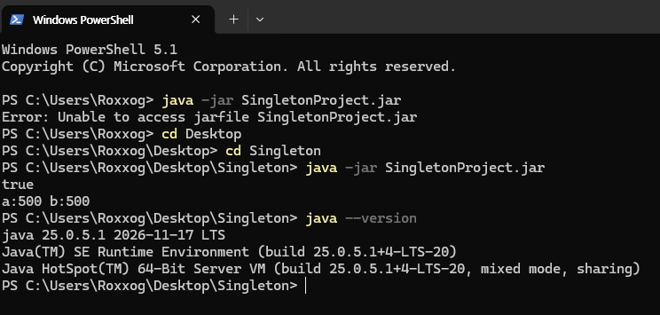
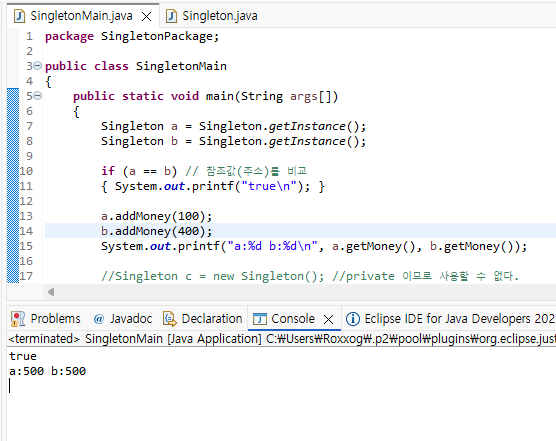

사용된 언어 : Java  
실습에 활용된 IDE : Eclipse IDE for Java Developers - 2026-09  
버전 : JavaSE-25  
 
실행 방법 : Eclipse IDE 환경에서 Java project 생성 --> package 생성 --> main 함수가 포함된 class인 SingletonMain에 SingletonMain.java의 명령어를 넣고 Singleton.java를 또 다른 클래스로 선언 후 최종 실행한다.  
또는 SingletonProject.jar (Runnable Jar File) 파일을 cmd를 통해 실행한다.  

 

#실행 결과

인스턴스는 static 변수로 선언되어 class에 소속된다. 실제 Singleton 객체인 instance는 힙 영역에 존재한다. 그 인스턴스를 a, b가 인스턴스의 주소를 통해 참조한다.

반복 요청 시 새 객체가 만들어지지 않는 이유는 유일한 생성자가 private로 설정되어 있기 때문에 class 외부에서 생성자를 호출할 수 없기 때문이다.
(생성자를 만들어 놓지 않을 경우 컴파일러가 외부에서 호출 가능한 생성자를 임의로 만들 수 있으므로 직접 private 생성자를 만들어야 한다.)

a, b는 Singleton의 instance를 참조한다. 그 것들 확인하는 방법으로 Java에서의 == 은 참조 비교(같은 주소를 가지는지)를 통해 a ,b가 같은 객체를 가리킨다는 것을 확인할 수 있다.

